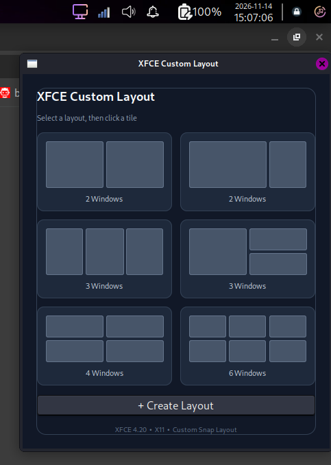

# XFCE Kali Linux Snap

A Windows 11-inspired Snap Layout Manager for Kali Linux XFCE, built with Python, GTK3 and X11.

## Features

- Windows 11-style Snap Layout popup
- Maximize button hover detection
- Predefined and customizable layouts
- Advanced Layout Editor (Split & Merge)
- Animated Window Snapping
- Rounded Snap Preview
- Customizable Preview Color
- Smart Divider & Dynamic Window Resize
- Snap Assist
- Snap Groups & Layout History
- System Tray & Settings
- Adjustable Hover Delay and Animation Speed
- Auto Start on XFCE Login

## Screenshots

### Snap Layout Popup

## Requirements

- Kali Linux XFCE (X11)
- Python 3
- GTK3 / PyGObject
- Python Xlib
- wmctrl
- xdotool
- x11-utils

## Installation

Clone the repository and run the installer:

    git clone https://github.com/Falco1337/XFCELayout.git
    cd xfce-kali-linux-snap
    chmod +x install.sh
    ./install.sh

Log out and log back in to start automatically.

Run the installer as your normal desktop user, not root.

## Usage

Hover over the maximize button to open Snap Layouts. Select a layout and click a zone to snap the window.

Use the system tray icon to open Settings, enable or disable Snap Layout, or quit the application.

## Configuration

Settings are stored in:

    ~/.config/snaplayout/settings.json

## Uninstallation

Run:

    ./uninstall.sh

Personal configuration files are preserved.

## Compatibility

Designed for Kali Linux XFCE running on X11. Wayland is not currently supported.

## License

To be determined before public release.
